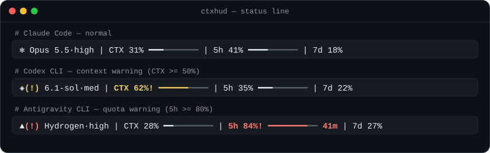

# ctxhud

> **Alpha — not yet validated in daily use.** Interfaces, config keys and on-disk formats may change without notice. Back up your agent settings before installing (`ctxhud install` also backs up what it touches, and `ctxhud install --dry-run` shows the diff first).

Per-session **context usage** and **plan quota** in the status line of your terminal AI coding agents, for Claude Code, Codex CLI and Antigravity CLI. One line, one session, no daemon.

[한국어 README](docs/README.ko.md)



## What it shows

```
✻ Example 1·high | CTX 30% ━━━━━━━━━━ | 5h 41% ━━━━━━━━━━ | 7d 18%
```

When something crosses a threshold, a `(!)` bubble appears right after the tool icon and the offending value gets a `!`. Quota warnings also show the time left until the reset:

```
✻(!) Example 1·high | CTX 62%! ━━━━━━━━━━ | 5h 84%! ━━━━━━━━━━ 42m | 7d 18%
```

| Part | Meaning |
|---|---|
| `✻` `◈` `▲` | Default icons for Claude Code, Codex CLI, Antigravity CLI. Plain Unicode symbols, not logos; replaceable in `config.json`. |
| `Example 1·high` | Model family and reasoning effort, as reported by the tool. |
| `CTX 62%!` | Share of this session's context window in use. Warns at 50% or more by default. |
| `5h 84%! 42m` | Usage of the 5-hour quota window. Warns at 80% or more by default; the time until reset is shown only while warning. |
| `7d 18%` | Usage of the weekly quota window. |
| `━━━━` | 10-cell bar (10% per cell) next to CTX and 5h. Colored only while warning. |
| `(!)` | Warning bubble. Yellow for a context warning, red if any quota warns. (`icons_style: "nerd"` swaps it for a Nerd Font glyph.) |

Other markers: `--[reset]` (the window has already reset), `[old 12m]` (quota observation older than 10 minutes), `CTX ~124k/?` (token count known, window size not), `~` (estimated). On narrow terminals the line drops, in order: bars, model, 7d, then 5h (when not warning). CTX is never dropped.

## Supported tools

| Tool | Tested version | How it is shown |
|---|---|---|
| Claude Code | 2.1.326 | Native `statusLine` command |
| Codex CLI | 0.169.0 | tmux `pane-border-format` + Codex's built-in footer items |
| Antigravity CLI (`agy`) | 1.5.10 | Native `statusLine` command |

Also tested with tmux 3.8, on macOS, with Python 3.9+. Linux has not been tested. Other versions may work but are untested; status line payloads are not stable public APIs.

## Install

Requires Python 3.9 or newer. There are no third-party dependencies.

```sh
uv tool install git+https://github.com/inuyeat/ctxhud
# or
pipx install git+https://github.com/inuyeat/ctxhud
```

Then preview and apply:

```sh
ctxhud install --dry-run   # prints a diff of every file it would change, writes nothing
ctxhud install             # applies it, with backups
ctxhud doctor              # checks paths, permissions, wiring, recent caches
```

To remove it:

```sh
ctxhud uninstall           # removes only what ctxhud added and restores what it replaced
```

Useful options: `--tools claude,agy,codex,tmux` limits the targets (default: every tool found on the machine), `--force` replaces an existing non-ctxhud `statusLine` after backing it up (without it, ctxhud stops and changes nothing), `--refresh-interval N` sets Claude's `refreshInterval` (default 30 s). Restart the agents afterwards. For tmux, run `tmux source-file ~/.tmux.conf` (install only edits the file, it never talks to a running tmux server).

`ctxhud tmux [dir]` is an optional helper that attaches to or creates a tmux session named after a project folder. `ctxhud list` prints every cached session for debugging.

## How it works

| Tool | Mechanism |
|---|---|
| Claude Code | `ctxhud install` sets `statusLine` in Claude's `settings.json` to `ctxhud bridge claude`. Claude pipes a JSON document to that command, ctxhud normalizes it, caches it and prints one line. |
| Antigravity CLI | Same idea: `statusLine` in agy's `settings.json` runs `ctxhud bridge agy`. |
| Codex CLI | Codex has no external status line command. ctxhud adds a marked block to `~/.tmux.conf` so that panes running `codex` draw `ctxhud codex-border` in their bottom border; other panes just show their title. The command maps pane → Codex process → its open session log, reads new lines incrementally (no daemon) and renders. ctxhud also sets Codex's built-in footer items (`context-used`, `five-hour-limit`, `weekly-limit`) in `config.toml` so both views are available. |

Edits are minimal and reversible: JSON and TOML are changed in place (only the relevant lines), a marker identifies what ctxhud owns, originals go to a backup folder, and a second `install` is a no-op. If a write fails midway, earlier writes are rolled back. A status line command never fails loudly: on any error it prints a minimal line, logs to a file, and exits 0.

## Privacy

- **No network calls.** ctxhud never opens a socket.
- **No credential access.** It does not read auth files, OAuth tokens or the macOS Keychain, and has no login flow.
- It only reads what the tools hand to the status line command, plus (for Codex) the session log that the pane's own Codex process already has open, found through `tmux`, `ps` and `lsof`.
- The cache keeps a small whitelist of fields (model, percentages, token counts, reset times, working directory, session id, tmux pane). Everything stays on your machine, files are mode `0600` and directories `0700`.
- Raw tool input is not stored unless you set `capture_raw` to `true` (off by default; meant for debugging).

Default locations (XDG, each overridable):

| What | Path | Override |
|---|---|---|
| Cache, state, logs | `~/.local/state/ctxhud/` (`cache/`, `raw/`, `codex/`, `log/`) | `CTXHUD_STATE_DIR`, `XDG_STATE_HOME` |
| Config | `~/.config/ctxhud/config.json` | `CTXHUD_CONFIG`, `XDG_CONFIG_HOME` |
| Claude home | `~/.claude` | `CLAUDE_CONFIG_DIR` |
| Codex home | `~/.codex` | `CODEX_HOME` |
| agy home | `~/.gemini/antigravity-cli` | `CTXHUD_AGY_HOME` |

## Configuration

Optional. Put any of these keys in `~/.config/ctxhud/config.json`; unknown keys are ignored and a broken file falls back to defaults. `NO_COLOR` is respected.

| Key | Default | Description |
|---|---|---|
| `ctx_warn` | `50` | Context usage (%) at which CTX warns. |
| `quota_warn` | `80` | 5h / weekly usage (%) at which quota warns. |
| `quota_old_sec` | `600` | Quota observations older than this show `[old Nm]`. |
| `ctx_age_sec` | `900` | Context observations older than this show their age. |
| `color` | `true` | ANSI / tmux colors. `false` prints plain text. |
| `bars` | `true` | Show the `━` bars next to CTX and 5h. |
| `bar_width` | `10` | Bar length in cells (10% per cell). |
| `bar_track_color` | `""` | `"#rrggbb"` for the empty part of a bar; empty = dim. |
| `icons` | `{"claude": "✻", "codex": "◈", "agy": "▲"}` | Per-tool icon. Use any single-width character. |
| `icon_colors` | `{"claude": "", "codex": "", "agy": ""}` | Per-tool icon color as `"#rrggbb"`; empty = terminal default. |
| `icons_style` | `"unicode"` | `"unicode"` shows `(!)` as the warning bubble; `"nerd"` uses a Nerd Font glyph. |
| `layout` | `"one-line"` | `"two-line"` splits CTX and quota onto two lines (status lines only; tmux borders stay one line). |
| `capture_raw` | `false` | Keep the last raw input per session under the state directory (debugging). |

Example:

```json
{
  "ctx_warn": 40,
  "icons": { "claude": "C", "codex": "X", "agy": "A" },
  "bars": false
}
```

## Limitations

- **Antigravity's `statusLine` is not in its public documentation as far as we could confirm.** ctxhud relies on the input that `agy` actually passes to the command, captured on a test machine. It can change or disappear in any release.
- **Codex borders work only inside tmux**, only for panes where the foreground command is `codex`, and appear **after the first message** of a session (until then the border shows an unresolved placeholder). If a pane cannot be mapped to exactly one Codex session, ctxhud shows nothing guessed.
- **Quota is based on local observation.** ctxhud shows the last value each tool reported on this machine. Usage from other devices, or from a session that has been idle, shows up with a delay (`[old Nm]` tells you how stale a value is). Quota figures are not a billing source.
- Claude quota appears only when Claude Code sends it (subscription plans, after the first response). agy shows the quota group of the current model only.
- Start-up cost matters because the command runs on every refresh. Installed with `uv tool` on the macOS system Python 3.9.6, `ctxhud bridge claude` measured p95 16 ms, and `codex-border` 18–20 ms when its cache is warm (the first call that maps a pane takes about 90 ms). These numbers come from one Mac.
- Codex pane mapping has been verified live on a single real tmux pane; several Codex panes in the same folder are still being validated.
- No Windows support. No compaction detection or prediction.

## Development

```sh
PYTHONPATH=src python3 -I -m unittest discover -s tests
```

The standard library is the only dependency, and Python 3.9 compatibility is part of the test matrix. Test fixtures are either invented data or real captures anonymized with `tests/tools/anonymize.py` (numbers rounded, IDs and paths replaced).

## Contributing

Issues and pull requests are welcome. This is a personal side project, so replies may be slow.

## Disclaimer

ctxhud is an unofficial, independent project. It is not affiliated with, endorsed by, or sponsored by Anthropic, OpenAI, or Google. Claude, Claude Code, Codex, ChatGPT, Gemini and Antigravity are trademarks of their respective owners and are used here only to describe compatibility. The tool uses no official logos.

## License

[MIT](LICENSE)
