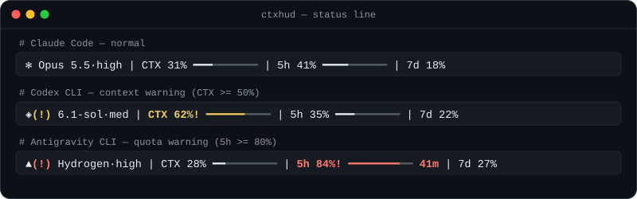

# ctxhud

> **Alpha — not yet validated in daily use.** (알파: 일상 사용으로 아직 검증되지 않았습니다.) 인터페이스, 설정 키, 디스크 포맷이 예고 없이 바뀔 수 있습니다. 설치 전에 에이전트 설정을 백업해 두세요. `ctxhud install`도 건드리는 파일을 백업하며, `ctxhud install --dry-run`으로 변경 내용을 먼저 볼 수 있습니다.

터미널 AI 코딩 에이전트(Claude Code, Codex CLI, Antigravity CLI)의 표시줄에 **세션별 컨텍스트 사용량**과 **요금제 한도**를 한 줄로 보여 주는 도구입니다. 데몬 없이 동작합니다.

[English README](../README.md)



## 무엇을 보여주나

```
✻ Example 1·high | CTX 30% ━━━━━━━━━━ | 5h 41% ━━━━━━━━━━ | 7d 18%
```

기준을 넘으면 도구 아이콘 바로 뒤에 `(!)` 말풍선이 붙고 해당 값에 `!`가 붙습니다. 쿼터 경고일 때는 리셋까지 남은 시간도 함께 나옵니다.

```
✻(!) Example 1·high | CTX 62%! ━━━━━━━━━━ | 5h 84%! ━━━━━━━━━━ 42m | 7d 18%
```

| 표시 | 의미 |
|---|---|
| `✻` `◈` `▲` | 기본 아이콘(Claude Code, Codex CLI, Antigravity CLI 순). 로고가 아닌 일반 유니코드 기호이며 `config.json`에서 바꿀 수 있습니다. |
| `Example 1·high` | 도구가 알려 준 모델 계열과 추론 수준. |
| `CTX 62%!` | 이 세션의 컨텍스트 윈도우 사용률. 기본값 50% 이상이면 경고. |
| `5h 84%! 42m` | 5시간 한도 사용률. 기본값 80% 이상이면 경고하며, 경고일 때만 리셋까지 남은 시간을 표시. |
| `7d 18%` | 주간 한도 사용률. |
| `━━━━` | CTX와 5h 옆의 10칸 막대(1칸 = 10%). 경고일 때만 색이 입혀집니다. |
| `(!)` | 경고 말풍선. 컨텍스트 경고는 노랑, 쿼터 경고가 하나라도 있으면 빨강. (`icons_style: "nerd"`면 Nerd Font 글리프로 대체) |

그 밖의 표시: `--[reset]`(이미 리셋된 윈도우), `[old 12m]`(10분 넘게 갱신되지 않은 쿼터 값), `CTX ~124k/?`(토큰 수만 알고 윈도우 크기는 모름), `~`(추정). 폭이 좁으면 막대 → 모델 → 7d → (경고가 아닌) 5h 순으로 생략하고, CTX는 생략하지 않습니다.

## 지원 도구

| 도구 | 테스트한 버전 | 표시 방식 |
|---|---|---|
| Claude Code | 2.1.326 | 네이티브 `statusLine` 명령 |
| Codex CLI | 0.169.0 | tmux `pane-border-format` + Codex 내장 footer 항목 |
| Antigravity CLI (`agy`) | 1.5.10 | 네이티브 `statusLine` 명령 |

tmux 3.8, macOS, Python 3.9 이상에서 테스트했습니다. Linux는 테스트하지 않았습니다. 다른 버전은 동작할 수도 있지만 검증하지 않았고, 표시줄 입력 형식은 안정적인 공개 API가 아닙니다.

## 설치

Python 3.9 이상이 필요하고 외부 의존성은 없습니다.

```sh
uv tool install git+https://github.com/inuyeat/ctxhud
# 또는
pipx install git+https://github.com/inuyeat/ctxhud
```

미리보기 후 적용합니다.

```sh
ctxhud install --dry-run   # 바뀔 파일의 diff만 출력하고 아무것도 쓰지 않음
ctxhud install             # 백업 후 적용
ctxhud doctor              # 경로·권한·연결 상태·최근 캐시 점검
```

제거:

```sh
ctxhud uninstall           # ctxhud가 넣은 것만 지우고, 교체했던 원본은 되돌림
```

주요 옵션: `--tools claude,agy,codex,tmux`로 대상을 제한(기본값은 이 컴퓨터에서 발견된 도구 전부), `--force`는 ctxhud 것이 아닌 기존 `statusLine`을 백업 후 교체(없으면 아무것도 바꾸지 않고 중단), `--refresh-interval N`은 Claude의 `refreshInterval` 설정(기본 30초). 적용 후 에이전트를 다시 시작하세요. tmux는 `tmux source-file ~/.tmux.conf`로 다시 불러와야 합니다(install은 설정 파일만 편집하며 실행 중인 tmux 서버와 통신하지 않습니다).

`ctxhud tmux [dir]`은 프로젝트 폴더 이름으로 tmux 세션을 만들거나 붙는 선택 기능이고, `ctxhud list`는 캐시된 모든 세션을 디버그용으로 출력합니다.

## 동작 방식

| 도구 | 방식 |
|---|---|
| Claude Code | `ctxhud install`이 Claude `settings.json`의 `statusLine`을 `ctxhud bridge claude`로 설정합니다. Claude가 이 명령에 JSON을 넘기면 ctxhud가 정규화·캐시하고 한 줄을 출력합니다. |
| Antigravity CLI | 같은 방식으로 agy `settings.json`의 `statusLine`이 `ctxhud bridge agy`를 실행합니다. |
| Codex CLI | Codex에는 외부 표시줄 명령이 없습니다. 그래서 `~/.tmux.conf`에 표시된 블록을 추가해, `codex`가 실행 중인 pane만 아래쪽 테두리에 `ctxhud codex-border`의 출력을 그리고 다른 pane은 제목만 보여 줍니다. 이 명령은 pane → Codex 프로세스 → 열려 있는 세션 로그를 찾아 새로 추가된 줄만 읽고(데몬 없음) 렌더링합니다. `config.toml`에는 Codex 내장 footer 항목(`context-used`, `five-hour-limit`, `weekly-limit`)도 함께 설정해 두 화면을 모두 쓸 수 있습니다. |

설정 편집은 최소한으로, 되돌릴 수 있게 합니다. JSON·TOML은 필요한 줄만 제자리에서 수정하고, 표식으로 ctxhud 소유분을 구분하며, 원본은 백업 폴더에 보관합니다. `install`을 한 번 더 실행해도 변화가 없습니다. 쓰기 도중 하나가 실패하면 앞서 쓴 파일을 되돌립니다. 표시줄 명령은 어떤 오류에서도 최소한의 한 줄만 출력하고 로그 파일에 기록한 뒤 종료 코드 0으로 끝납니다.

## Privacy

- **네트워크 호출 0.** ctxhud는 소켓을 열지 않습니다.
- **인증 정보 접근 0.** 인증 파일, OAuth 토큰, macOS Keychain을 읽지 않으며 로그인 과정도 없습니다.
- 읽는 것은 각 도구가 표시줄 명령에 넘겨 주는 입력과, (Codex의 경우) 해당 pane의 Codex 프로세스가 이미 열어 둔 세션 로그뿐입니다. 이를 찾기 위해 `tmux`, `ps`, `lsof`를 호출합니다.
- 캐시에는 모델, 퍼센트, 토큰 수, 리셋 시각, 작업 디렉터리, 세션 ID, tmux pane 등 소수의 허용 필드만 저장합니다. 모두 내 컴퓨터 안에만 있고 파일 권한은 `0600`, 디렉터리는 `0700`입니다.
- `capture_raw`를 `true`로 켜지 않는 한 원본 입력은 저장하지 않습니다(기본값 꺼짐, 디버그용).

기본 경로(XDG 준수, 모두 재정의 가능):

| 용도 | 경로 | 재정의 |
|---|---|---|
| 캐시·상태·로그 | `~/.local/state/ctxhud/` (`cache/`, `raw/`, `codex/`, `log/`) | `CTXHUD_STATE_DIR`, `XDG_STATE_HOME` |
| 설정 | `~/.config/ctxhud/config.json` | `CTXHUD_CONFIG`, `XDG_CONFIG_HOME` |
| Claude 홈 | `~/.claude` | `CLAUDE_CONFIG_DIR` |
| Codex 홈 | `~/.codex` | `CODEX_HOME` |
| agy 홈 | `~/.gemini/antigravity-cli` | `CTXHUD_AGY_HOME` |

## 설정

선택 사항입니다. 아래 키를 `~/.config/ctxhud/config.json`에 넣으면 됩니다. 모르는 키는 무시하고, 파일이 깨졌으면 기본값을 씁니다. `NO_COLOR` 환경변수를 존중합니다.

| 키 | 기본값 | 설명 |
|---|---|---|
| `ctx_warn` | `50` | CTX 경고 기준(사용률 %). |
| `quota_warn` | `80` | 5h·주간 경고 기준(사용률 %). |
| `quota_old_sec` | `600` | 이 시간(초)보다 오래된 쿼터 관측은 `[old Nm]`로 표시. |
| `ctx_age_sec` | `900` | 이 시간(초)보다 오래된 컨텍스트 관측은 나이를 표시. |
| `color` | `true` | ANSI·tmux 색 사용. `false`면 일반 텍스트. |
| `bars` | `true` | CTX와 5h 옆의 `━` 막대 표시. |
| `bar_width` | `10` | 막대 길이(칸, 1칸 = 10%). |
| `bar_track_color` | `""` | 막대의 빈 부분 색 `"#rrggbb"`. 비우면 dim 처리. |
| `icons` | `{"claude": "✻", "codex": "◈", "agy": "▲"}` | 도구별 아이콘. 폭 1칸 문자를 쓰세요. |
| `icon_colors` | `{"claude": "", "codex": "", "agy": ""}` | 도구별 아이콘 색 `"#rrggbb"`. 비우면 터미널 기본색. |
| `icons_style` | `"unicode"` | `"unicode"`는 경고 말풍선을 `(!)`로, `"nerd"`는 Nerd Font 글리프로 표시. |
| `layout` | `"one-line"` | `"two-line"`은 CTX와 쿼터를 두 줄로 나눔(표시줄 전용, tmux 테두리는 항상 한 줄). |
| `capture_raw` | `false` | 세션별 마지막 원본 입력을 상태 디렉터리에 보관(디버그용). |

예시:

```json
{
  "ctx_warn": 40,
  "icons": { "claude": "C", "codex": "X", "agy": "A" },
  "bars": false
}
```

## Limitations

- **Antigravity의 `statusLine`은 확인 가능한 범위에서 공식 문서에 없는 기능입니다.** ctxhud는 테스트 기기에서 `agy`가 명령에 실제로 넘겨 준 입력을 근거로 구현했으며, 어느 릴리스에서든 바뀌거나 사라질 수 있습니다.
- **Codex 테두리는 tmux 안에서만** 동작하고, 전경 명령이 `codex`인 pane에서만, 세션의 **첫 메시지 이후**에 표시됩니다(그 전에는 unresolved 자리표시가 나옵니다). pane을 정확히 하나의 Codex 세션에 대응시키지 못하면 추측하지 않고 표시하지 않습니다.
- **쿼터는 로컬 관측 기반입니다.** 이 기기에서 각 도구가 마지막으로 알려 준 값을 보여 주므로, 다른 기기나 한동안 쉬고 있던 세션의 사용량은 지연되어 반영됩니다(`[old Nm]`이 값의 오래된 정도를 알려 줍니다). 쿼터 수치는 과금 근거가 아닙니다.
- Claude 쿼터는 Claude Code가 보내 줄 때만 나타납니다(구독 플랜, 첫 응답 이후). agy는 현재 모델 그룹의 쿼터만 보여 줍니다.
- 표시줄 명령은 갱신 때마다 실행되므로 시작 비용이 중요합니다. `uv tool`로 설치해 macOS 시스템 Python 3.9.6에서 측정하면 `ctxhud bridge claude`는 p95 16ms, `codex-border`는 캐시가 있을 때 18~20ms입니다(pane을 처음 매핑하는 호출은 약 90ms). 이 수치는 Mac 한 대에서 잰 값입니다.
- Codex pane 매핑은 실제 tmux pane 1개에서 라이브로 확인했고, 같은 폴더의 Codex pane이 여러 개인 경우는 아직 검증 중입니다.
- Windows는 지원하지 않습니다. 압축(compaction) 감지·예측 기능도 없습니다.

## 개발

```sh
PYTHONPATH=src python3 -I -m unittest discover -s tests
```

의존성은 표준 라이브러리뿐이며, Python 3.9 호환성이 테스트 범위에 포함됩니다. 테스트 fixture는 직접 만든 가짜 데이터이거나, `tests/tools/anonymize.py`로 익명화한 실캡처(수치 반올림, ID·경로 치환)입니다.

## 기여

이슈와 풀 리퀘스트를 환영합니다. 개인 사이드 프로젝트라 답변이 늦을 수 있어요.

## Disclaimer

ctxhud는 비공식 독립 프로젝트이며 Anthropic, OpenAI, Google과 제휴·후원·승인 관계가 없습니다. Claude, Claude Code, Codex, ChatGPT, Gemini, Antigravity는 각 소유자의 상표이며, 여기서는 호환 대상을 설명하는 용도로만 사용합니다. 공식 로고는 사용하지 않습니다.

## License

[MIT](../LICENSE)
